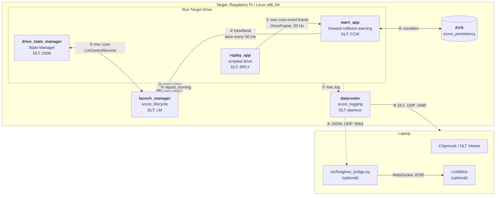

# Drive Replay Demo

A scripted 40 s highway lap is replayed into a forward collision warning (FCW). All
processes are started and supervised by the S-CORE launch manager; if the FCW hangs or
crashes, the system falls back to a degraded mode and recovers. Every step is visible
in the DLT log. How to run it, the CI test and the Chipmunk / Lichtblick setup are
described in [showcases/README.md](../README.md#drive-replay-demo).

## Architecture

The launch manager also starts the `datarouter` and logs through it (⑦). Solid arrows are
S-CORE interfaces, dotted arrows are lifecycle reports and the optional visualization feed.

### Information flows

| # | From → to | S-CORE module / API | Transport | Content |
|---|---|---|---|---|
| ① | `replay_app` → `warn_app` | score_communication, `mw::com` skeleton / proxy, service `score/showcases/drive_replay/DriveData` ([drive_data.h](drive_data.h)) | shared memory (LoLa) | event `frame`: sequence number, simulation time, position and speed of ego and lead vehicle, scenario phase |
| ② | `warn_app` → `launch_manager` | score_lifecycle, health monitor (heartbeat monitor 10–300 ms) and alive supervision | shared memory | alive notifications every 50 ms; none after the injected hang → `Alive Supervision (warn_app) switched to FAILED` |
| ③ | `launch_manager` → all processes | score_lifecycle, launch manager ([configs/launch_manager_config.json](configs/launch_manager_config.json)) | process start / `SIGTERM` | Run Target `Drive` (all processes) or `fallback_run_target` (without `warn_app`) |
| ④ | apps → `launch_manager` | score_lifecycle, lifecycle client `report_running()` | file descriptor from the launch manager | "process is up", completes the Run Target transition |
| ⑤ | `drive_state_manager` ↔ `launch_manager` | score_lifecycle, `ILmControl` over score_communication ([configs/mw_com_config.json](configs/mw_com_config.json)) | shared memory (LoLa) | event `ActivationResult` (Run Target reached, source: initial / request / recovery), method `ActivateRunTarget("Drive")` |
| ⑥ | `warn_app` ↔ KVS | score_persistency, `score::kvs::Kvs` | JSON files with hash | `start_count`, `warn_count`; restored after every restart |
| ⑦ | all processes → `datarouter` | score_logging, `mw::log` (`kConsole\|kRemote`, app ids in `configs/logging*.json`) | shared memory + Unix socket | log messages with app id / context id |
| ⑧ | `datarouter` → laptop | score_logging, datarouter ([deploy/logging/etc](../../deploy/logging/etc)) | DLT over UDP multicast | all logs as DLT, viewed in Chipmunk ([viz/chipmunk_presets.json](viz/chipmunk_presets.json)) or forwarded to Lichtblick |
| ⑨ | apps → bridge (optional) | none, plain UDP ([viz_link.h](viz_link.h)) | JSON over UDP | `drive` (positions, speeds, gap), `warn` (TTC, level, counters), `system` (Run Target, degraded) |

### S-CORE modules per process

| Process | communication | lifecycle | logging | persistency |
|---|---|---|---|---|
| `launch_manager` | offers `LmControlService` | is the launch manager, evaluates alive supervision | logs to DLT | – |
| `drive_state_manager` | `ILmControl` client | State Manager, `report_running()` | logs to DLT | – |
| `replay_app` | offers `DriveData` | `report_running()` | logs to DLT | – |
| `warn_app` | uses `DriveData` | health monitor (heartbeat), `report_running()` | logs to DLT | KVS |
| `datarouter` | – | started as `Native` component | is the DLT daemon | – |

score_baselibs is used underneath by all of them (argument parsing, result types, `mw::log` frontend).
