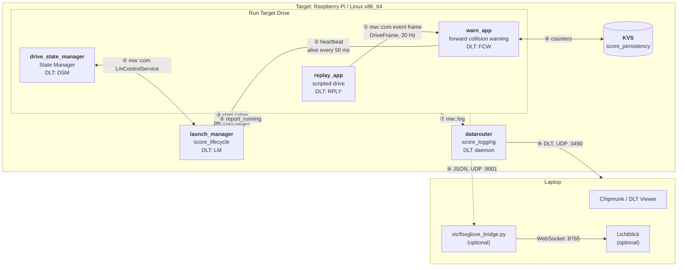

# Drive Replay Demo

A scripted 40 s highway lap is replayed into a forward collision warning (FCW). All
processes are started and supervised by the S-CORE launch manager; if the FCW hangs or
crashes, the system falls back to a degraded mode and recovers. Every step is visible
in the DLT log.

https://github.com/user-attachments/assets/c437673f-8da0-42bd-86b4-0e9015847fa5

*Video (53 s): how the S-CORE modules work together, recorded from a real run.*

## Architecture



The launch manager also starts the `datarouter` and logs through it (⑦). Solid arrows are
S-CORE interfaces, dotted arrows are lifecycle reports and the optional visualization feed.

### Information flows

| # | From → to | S-CORE module / API | Transport | Content |
|---|---|---|---|---|
| ① | `replay_app` → `warn_app` | score_communication, `mw::com` skeleton / proxy, service `score/showcases/drive_replay/DriveData` ([drive_data.h](drive_data.h)) | shared memory (LoLa) | event `frame`: sequence number, simulation time, position and speed of ego and lead vehicle, scenario phase |
| ② | `warn_app` → `launch_manager` | score_lifecycle, health monitor (heartbeat monitor 10–300 ms) and alive supervision | shared memory | alive notifications every 50 ms; none after the injected hang → `Alive Supervision (warn_app) switched to FAILED` |
| ③ | `launch_manager` → all processes | score_lifecycle, launch manager ([configs/launch_manager_config.json](configs/launch_manager_config.json)) | process start / `SIGTERM` | Run Target `Drive` (all processes) or `fallback_run_target` (without `warn_app`) |
| ④ | apps → `launch_manager` | score_lifecycle, lifecycle client `report_running()` | file descriptor from the launch manager | "process is up", completes the Run Target transition |
| ⑤ | `drive_state_manager` ↔ `launch_manager` | score_lifecycle, `ILmControl` over score_communication ([configs/mw_com_config.json](configs/mw_com_config.json)) | shared memory (LoLa) | event `ActivationResult` (Run Target reached, source: initial / request / recovery), method `ActivateRunTarget("Drive")` |
| ⑥ | `warn_app` ↔ KVS | score_persistency, `score::kvs::Kvs` | JSON files with hash | `start_count`, `warn_count`; restored after every restart |
| ⑦ | all processes → `datarouter` | score_logging, `mw::log` (`kConsole\|kRemote`, app ids in `configs/logging*.json`) | shared memory + Unix socket | log messages with app id / context id |
| ⑧ | `datarouter` → laptop | score_logging, datarouter ([deploy/logging/etc](../../deploy/logging/etc)) | DLT over UDP multicast | all logs as DLT, viewed in Chipmunk ([viz/chipmunk_presets.json](viz/chipmunk_presets.json)) or forwarded to Lichtblick |
| ⑨ | apps → bridge (optional, off by default) | none, plain UDP ([viz_link.h](viz_link.h)) | JSON over UDP | `drive` (positions, speeds, gap), `warn` (TTC, level, counters), `system` (Run Target, degraded) |

### S-CORE modules per process

| Process | communication | lifecycle | logging | persistency |
|---|---|---|---|---|
| `launch_manager` | offers `LmControlService` | is the launch manager, evaluates alive supervision | logs to DLT | – |
| `drive_state_manager` | `ILmControl` client | State Manager, `report_running()` | logs to DLT | – |
| `replay_app` | offers `DriveData` | `report_running()` | logs to DLT | – |
| `warn_app` | uses `DriveData` | health monitor (heartbeat), `report_running()` | logs to DLT | KVS |
| `datarouter` | – | started as `Native` component | is the DLT daemon | – |

score_baselibs is used underneath by all of them (argument parsing, result types, `mw::log` frontend).

## Fault handling

If `warn_app` hangs (no more heartbeats) or crashes, the launch manager switches to the
degraded `fallback_run_target`: the drive continues, the collision warning is off. The
state manager requests `Drive` again after 3 s; the restarted `warn_app` restores its
counters from the KVS.

## Run on the target

```sh
# scripted (~65 s, hang after 20 s, crash after 45 s, then stop):
/showcases/bin/cli --examples 'Drive Replay Demo'
# live, until Ctrl-C:
cd /showcases/data/drive_replay && /usr/bin/launch_manager
# inject a fault from a second shell:
/showcases/bin/lifecycle_signal.sh warn_app SIGUSR1   # hang (no more heartbeats)
/showcases/bin/lifecycle_signal.sh warn_app SIGKILL   # crash
```

The launch manager needs POSIX ACL support on `/dev/shm` (alive supervision). Docker Desktop
(linuxkit kernel) does not provide it; Raspberry Pi OS and Ubuntu do.

## Platform integration test

`//platform_integration_tests/drive_replay` (Linux x86_64) runs the scripted showcase and
records its DLT traffic; CI uploads it as artifact `drive-replay-dlt-<sha>`. The test checks
the chain in the trace: drive and warnings (`RPLY`, `FCW`), exactly one supervision failure
of `warn_app` and only after the injected hang, two recoveries (`LM` `fallback_run_target`,
`DSM` requesting `Drive`, `LM` `Drive` again) and the restarted `warn_app` restoring its
counters (`start #3, restored warn_count>0`).

## View the trace in Chipmunk

[viz/chipmunk_presets.json](viz/chipmunk_presets.json) is a named preset for
[Chipmunk](https://github.com/esrlabs/chipmunk) 4.x: open `drive_replay.dlt` (CI artifact, or
recorded from `239.255.42.99:3490`), then in the bottom panel *Presets* use *Import named
presets* and apply "S-CORE Drive Replay". It adds

* colored filters that reduce the trace to the story: scenario (grey), warning (yellow),
  critical (red), resolved (green), fault injected (pink), supervision failure / crash (dark red),
  Run Target changes of `LM` (blue), recovery requests of `DSM` (violet), restart with restored
  counters (cyan);
* charts from the measurement lines that `RPLY` and `FCW` log every 0.5 s: gap, time to
  collision (capped at 10 s), ego and lead speed.

## Live visualization in Lichtblick (optional)

The live data feed (⑨) is off by default. Switch it on before starting the launch manager
by writing a destination into `etc/drive_viz_addr` (read by every app at start; the
environment variable `DRIVE_VIZ_ADDR` takes precedence):

```sh
echo 239.255.42.99:9001 > /showcases/data/drive_replay/etc/drive_viz_addr   # multicast
echo <laptop ip>:9001   > /showcases/data/drive_replay/etc/drive_viz_addr   # or unicast
```

On a laptop in the same network, from the repository root (Python >= 3.10):

```sh
pip install -r showcases/drive_replay/viz/requirements.txt
python3 showcases/drive_replay/viz/foxglove_bridge.py --interface <laptop ip>
```

In Lichtblick open the connection `Foxglove WebSocket` -> `ws://127.0.0.1:8765` and import
the layout [viz/lichtblick_layout.json](viz/lichtblick_layout.json), or add the panels:

* 3D panel: topic `/scene`, display frame `ego`
* Plot panel: `/adas/fcw.ttc`, `/drive/frame.gap`, `/drive/frame.ego_kmh`, `/drive/frame.lead_kmh`
* State Transitions panel: `/system/state.run_target`, `/adas/fcw.level`
* Indicator panel: `/system/health.fcw_alive`
* Log panel: topic `/log`: warnings, errors and info events of LM, DSM, RPLY, FCW; the bridge
  drops debug output and the 0.5 s measurement lines, which the plots show instead

`//showcases/drive_replay/viz:foxglove_bridge_test` covers the DLT parser, the log filter and
the 3D scene.
